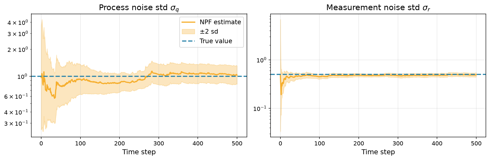

# Online Parameter Estimation with a Nested Particle Filter

In a separate [tutorial](parameter_estimation_em.md), we used the expectation
maximization algorithm to estimate unknown parameters in a state-space model.
This was done offline, meaning we had all the observations available. In some
cases we would instead like to estimate the parameters **online**, obtaining
estimates as data come in and updating them with each new observation.

For instance, in the [Kalman tracking example](kalman_tracking.md) we tracked a
car in 2D from noisy position measurements, assuming that we knew exactly how
noisy the car's motion and the measurements were. In practice, these noise levels
are rarely known, and in a real-time tracking system we would want to learn them
at the same time as tracking the car, as each new measurement arrives.

The [nested particle filter](../api_cuthbert/smc/nested_particle_filter.md)
(NPF) of [Crisan and Míguez (2018)](https://www.jstor.org/stable/26492094) is
one method for doing this. It runs an *outer* particle filter over the unknown parameters
$\theta$, where each outer particle carries its own *inner* filter for the state
$x_t$ given that value of $\theta$. In the original paper the inner filter is
another particle filter, but in `cuthbert` it can be any filter. Here, the
model is linear-Gaussian given $\theta$, so we use an exact Kalman filter as the
inner filter, giving a *nested hybrid filter*.

## Setup and imports

```{.python #npf-imports}
import jax
import matplotlib.pyplot as plt
from jax import jit, nn, random
from jax import numpy as jnp

from cuthbert import filter
from cuthbert.gaussian import kalman
from cuthbert.smc import nested_particle_filter, particle_filter
from cuthbertlib.resampling import systematic
```

## The model

We use the same constant-velocity model as in the [Kalman tracking
example](kalman_tracking.md), where the state $x_t = (x, y, \dot{x}, \dot{y})$
is the car's position and velocity. The difference is that now the process noise
standard deviation $\sigma_q$ and the measurement noise standard deviation
$\sigma_r$ are unknown:

\begin{align*}
    x_{t+1} \mid x_{t}, \theta & \sim \mathcal{N}(F x_{t}, \sigma_q^2 Q), \\
    y_{t} \mid x_{t}, \theta & \sim \mathcal{N}(H x_{t}, \sigma_r^2 I), \qquad \theta = (\sigma_q, \sigma_r).
\end{align*}

Here $F$, $Q$ and $H$ are the fixed matrices of the constant-velocity model,
with time step $\Delta t = 0.1$.

```{.python #npf-model}
dt = 0.1
F = jnp.array([[1, 0, dt, 0], [0, 1, 0, dt], [0, 0, 1, 0], [0, 0, 0, 1]])
c = jnp.zeros(4)
Q = jnp.array(
    [
        [dt**3 / 3, 0, dt**2 / 2, 0],
        [0, dt**3 / 3, 0, dt**2 / 2],
        [dt**2 / 2, 0, dt, 0],
        [0, dt**2 / 2, 0, dt],
    ]
)
chol_Q = jnp.linalg.cholesky(Q)
H = jnp.array([[1.0, 0, 0, 0], [0, 1, 0, 0]])
d = jnp.zeros(2)

m0 = jnp.array([0.0, 0.0, 1.0, -1.0])
chol_P0 = 0.05 * jnp.eye(4)
```

We simulate $T = 500$ measurements with true values $\sigma_q = 1$ and $\sigma_r = 0.5$.

```{.python #npf-simulate}
TRUE_SIGMA_Q, TRUE_SIGMA_R = 1.0, 0.5
NUM_STEPS = 500


def simulate(key, sigma_q, sigma_r, num_steps):
    key, init_key = random.split(key)
    x0 = m0 + chol_P0 @ random.normal(init_key, (4,))

    def step(x, step_key):
        state_key, obs_key = random.split(step_key)
        x = F @ x + sigma_q * chol_Q @ random.normal(state_key, (4,))
        y = H @ x + sigma_r * random.normal(obs_key, (2,))
        return x, (x, y)

    _, (xs, ys) = jax.lax.scan(step, x0, random.split(key, num_steps))
    return jnp.concatenate([x0[None], xs]), ys


true_states, ys = simulate(random.key(1), TRUE_SIGMA_Q, TRUE_SIGMA_R, NUM_STEPS)
```

## Defining the model for the nested particle filter

To build an NPF, we need to specify three things:

1. **The inner filter**: a filter for the state $x_t$ given a parameter value
   $\theta$.
2. **The outer model**: a prior distribution on $\theta$ that we can sample
   from, and a *jittering* kernel (i.e., a function that takes a parameter
   value and returns a new one by adding noise to it).
3. **How the parameter reaches the inner filter**: a function that adds
   $\theta$ to the model inputs that the inner filter receives.

### The inner filter

Since the model is linear-Gaussian given $\theta$, we use a Kalman filter as the
inner filter. It is a standard `cuthbert` filter, built exactly as if $\theta$
were known, except that $\theta$ is read from the `model_inputs`. We choose the
inner model inputs to be a dictionary `{"param": theta, "y": y_t}`. Since
$\sigma_q$ and $\sigma_r$ need to be positive, we parametrize $\theta$ by
`log_sigma_q` and `log_sigma_r`.

```{.python #npf-inner-filter}
def get_dynamics_params(model_inputs):
    sigma_q = jnp.exp(model_inputs["param"]["log_sigma_q"])
    return F, c, sigma_q * chol_Q


def get_observation_params(model_inputs):
    sigma_r = jnp.exp(model_inputs["param"]["log_sigma_r"])
    return H, d, sigma_r * jnp.eye(2), model_inputs["y"]


inner_filter = kalman.build_filter(
    m0, chol_P0, get_dynamics_params, get_observation_params
)
```

### The outer model

The outer particles are parameter values, which can be any pytree (here a
dictionary). We need a function to sample from the prior, for which we use
log-uniform priors $\sigma_q \sim \log \mathcal{U}(0.3, 3)$ and
$\sigma_r \sim \log \mathcal{U}(0.05, 5)$.

```{.python #npf-init-param}
def init_param_sample(key):
    q_key, r_key = random.split(key)
    return {
        "log_sigma_q": random.uniform(q_key, minval=jnp.log(0.3), maxval=jnp.log(3.0)),
        "log_sigma_r": random.uniform(r_key, minval=jnp.log(0.05), maxval=jnp.log(5.0)),
    }
```

The parameters are static, but if we never moved the outer particles, repeated
resampling would leave us with fewer and fewer distinct parameter values over
time. The NPF avoids this by *jittering* the parameters, i.e., adding a small
amount of noise to them. In `cuthbert`, the jittering kernel is only applied
right after the outer particles have been resampled, so that no noise is added
unnecessarily. We specify the jittering kernel by defining a
`propagate_param_sample` function.

```{.python #npf-jitter}
JITTER_SCALE = 0.025


def propagate_param_sample(key, param, model_inputs):
    q_key, r_key = random.split(key)
    return {
        "log_sigma_q": param["log_sigma_q"] + JITTER_SCALE * random.normal(q_key),
        "log_sigma_r": param["log_sigma_r"] + JITTER_SCALE * random.normal(r_key),
    }
```

The `model_inputs` argument to the kernel is ignored in this example, but it
gives a lot of flexibility, for example to use a different kernel at each time
step.

!!! tip "Choosing how much to jitter the parameters"
    The amount by which we jitter the parameters, which in our case is
    controlled by `JITTER_SCALE`, trades off particle diversity against
    accuracy. If it's too small, the outer particles collapse onto a few
    parameter values. If it's too large, the extra noise inflates the parameter
    posterior. [Crisan and Míguez (2018)](https://www.jstor.org/stable/26492094)
    recommend shrinking the jittering variance as the number of outer particles
    grows.

### Connecting the outer and inner models

Finally, we tell the NPF how to build the inner filter's model inputs from a
parameter value and the outer model inputs, which here are just the measurements
$y_t$. This must match how the inner filter reads its model inputs above.

```{.python #npf-add-param}
def add_param_to_model_inputs(param, y):
    return {"param": param, "y": y}
```

## Build and run the nested particle filter

We can now build the NPF, with 1000 outer particles and adaptive resampling
when the effective sample size falls below half the number of particles.

The NPF processes measurements one at a time, so its estimate at time $t$ only
uses the measurements up to time $t$. For convenience, we process our whole
dataset at once with `cuthbert.filter`, like any other filter. This gives
exactly the same results as feeding in the measurements one by one as they
arrive, which we'll do [at the end](#updating-online-with-a-new-measurement) for
a new measurement.

```{.python #npf-build}
npf = nested_particle_filter.build_filter(
    inner_filter=inner_filter,
    init_param_sample=init_param_sample,
    propagate_param_sample=propagate_param_sample,
    add_param_to_model_inputs=add_param_to_model_inputs,
    n_filter_particles=1_000,
    resampling_fn=systematic.resampling,
    ess_threshold=0.5,
)

init_key, filter_key = random.split(random.key(0))
init_state = npf.init_prepare(key=init_key)
states = jit(filter, static_argnames="filter_obj")(
    npf, ys, init_state, key=filter_key
)
```

The NPF is just a particle filter whose particles are
[`NestedParticle`](../api_cuthbert/smc/nested_particle_filter.md)s,
so `states` is a standard particle filter state. Each `NestedParticle` contains
a parameter value `param` and the state `inner_state` of an inner Kalman filter
conditional on `param`. Since we processed the whole dataset at once, every
leaf has a leading time axis of length $T + 1$, followed by an axis over the
outer particles.

```{.python #npf-shapes}
weights = nn.softmax(states.log_weights, axis=-1)  # (T + 1, 1000)
params = states.particles.param  # {"log_sigma_q": (T + 1, 1000), "log_sigma_r": ...}
inner_means = states.particles.inner_state.mean  # (T + 1, 1000, 4)
```

## Results

Let's look at how the posterior of each parameter evolves as more measurements
arrive. We plot the weighted mean and a $\pm 2$ standard deviation band,
computed in log space.

??? "Code to plot the parameter estimates."
    ```{.python #npf-plot-params}
    def weighted_mean_and_sd(x, w):
        mean = jnp.sum(w * x, axis=-1)
        sd = jnp.sqrt(jnp.sum(w * (x - mean[:, None]) ** 2, axis=-1))
        return mean, sd


    fig, axes = plt.subplots(1, 2, figsize=(12, 4))
    for ax, name, label, truth in [
        (axes[0], "log_sigma_q", "Process noise std $\\sigma_q$", TRUE_SIGMA_Q),
        (axes[1], "log_sigma_r", "Measurement noise std $\\sigma_r$", TRUE_SIGMA_R),
    ]:
        mean, sd = weighted_mean_and_sd(params[name], weights)
        ax.plot(jnp.exp(mean), color="#F6AE2D", linewidth=2, label="NPF estimate")
        ax.fill_between(
            jnp.arange(NUM_STEPS + 1),
            jnp.exp(mean - 2 * sd),
            jnp.exp(mean + 2 * sd),
            color="#F6AE2D",
            alpha=0.3,
            label="$\\pm 2$ sd",
        )
        ax.axhline(truth, color="#2E86AB", linestyle="--", linewidth=2, label="True value")
        ax.set_yscale("log")
        ax.set_xlabel("Time step", fontsize=12)
        ax.set_title(label, fontsize=14)
        ax.grid(True, alpha=0.3)
    axes[0].legend(fontsize=11)
    plt.tight_layout()
    plt.savefig("docs/assets/nested_pf_params.png", dpi=150, bbox_inches="tight")
    plt.close()
    ```



Both posteriors concentrate around the true values as measurements arrive. The
measurement noise $\sigma_r$ is learned quickly, since every measurement is
directly informative about it, while the process noise $\sigma_q$ needs more
data.

We can also estimate the car's position. The NPF's filtering distribution for
$x_t$ is a mixture of the inner Kalman filters' Gaussians, weighted by the outer
weights, so its mean is the weighted average of the inner means. Let's compare
it to a Kalman filter that knows the true parameters.

```{.python #npf-position}
npf_position = jnp.sum(weights[..., None] * inner_means[..., :2], axis=1)

oracle = kalman.build_filter(
    m0,
    chol_P0,
    lambda y: (F, c, TRUE_SIGMA_Q * chol_Q),
    lambda y: (H, d, TRUE_SIGMA_R * jnp.eye(2), y),
)
oracle_position = filter(oracle, ys, oracle.init_prepare()).mean[:, :2]


def rmse(position):  # over the measurement times t = 1, ..., T
    return jnp.sqrt(jnp.mean(jnp.sum((position - true_states[1:, :2]) ** 2, -1)))


print(f"Measurement RMSE: {rmse(ys):.3f}")
print(f"NPF RMSE:         {rmse(npf_position[1:]):.3f}")
print(f"Oracle RMSE:      {rmse(oracle_position[1:]):.3f}")
```

Running the above code yields
```txt
Measurement RMSE: 0.690
NPF RMSE:         0.405
Oracle RMSE:      0.402
```

The NPF tracks the car almost as well as the Kalman filter that knows the true
noise levels, while learning those noise levels at the same time.

## Updating online with a new measurement

In a real-time tracking system, measurements keep arriving after the ones we
have processed. To incorporate a new measurement, we take the latest filter
state and apply a single step of the filter with `npf.filter_prepare` and
`npf.filter_combine`, without reprocessing any of the earlier measurements.

```{.python #npf-online-update}
# Latest filter state, i.e., after processing the T measurements so far
state = jax.tree.map(lambda x: x[-1], states)

# The car moves on and we receive a new measurement
state_key, obs_key, update_key = random.split(random.key(2), 3)
next_true_state = F @ true_states[-1] + TRUE_SIGMA_Q * chol_Q @ random.normal(
    state_key, (4,)
)
y_new = H @ next_true_state + TRUE_SIGMA_R * random.normal(obs_key, (2,))

# Update the filter with the new measurement only
new_state = npf.filter_combine(state, npf.filter_prepare(y_new, key=update_key))


def posterior_mean_sigmas(state):
    w = nn.softmax(state.log_weights)
    sigma_q = jnp.sum(w * jnp.exp(state.particles.param["log_sigma_q"]))
    sigma_r = jnp.sum(w * jnp.exp(state.particles.param["log_sigma_r"]))
    return f"sigma_q = {sigma_q:.3f}, sigma_r = {sigma_r:.3f}"


new_weights = nn.softmax(new_state.log_weights)
new_position = jnp.sum(
    new_weights[:, None] * new_state.particles.inner_state.mean[:, :2], axis=0
)
print(f"Before update: {posterior_mean_sigmas(state)}")
print(f"After update:  {posterior_mean_sigmas(new_state)}")
print(f"Estimated position: {new_position}, true position: {next_true_state[:2]}")
```

Running the above code yields
```txt
Before update: sigma_q = 1.037, sigma_r = 0.495
After update:  sigma_q = 1.060, sigma_r = 0.502
Estimated position: [ 317.11243 -146.18835], true position: [ 317.1505 -145.9965]
```

The update refines the parameter estimates and gives an estimate of the car's
new position. In a live system, we would repeat this step for each new
measurement as it arrives, and wrap it in `jax.jit` to make each update fast.
See the [online filtering example](online_stoch_vol.md) for more on online
filtering with `cuthbert`.

??? tip "Bonus: A fully particle-based nested particle filter"
    If the model given $\theta$ were not linear-Gaussian, we could use a
    particle filter as the inner filter instead, as in the original
    algorithm of [Crisan and Míguez (2018)](https://www.jstor.org/stable/26492094).
    Only the inner filter changes: the outer model and
    `add_param_to_model_inputs` stay the same, and the inner model
    functions read $\theta$ from their model inputs in the same way.

    ```{.python #npf-bonus-pf-inner}
    def init_sample(key):
        return m0 + chol_P0 @ random.normal(key, (4,))


    def propagate_sample(key, x, model_inputs):
        sigma_q = jnp.exp(model_inputs["param"]["log_sigma_q"])
        return F @ x + sigma_q * chol_Q @ random.normal(key, (4,))


    def log_potential(x_prev, x, model_inputs):
        sigma_r = jnp.exp(model_inputs["param"]["log_sigma_r"])
        y = model_inputs["y"]
        return jnp.sum(jax.scipy.stats.norm.logpdf(y, H @ x, sigma_r))


    inner_pf = particle_filter.build_filter(
        init_sample,
        propagate_sample,
        log_potential,
        n_filter_particles=50,
        resampling_fn=systematic.resampling,
    )
    npf_pf = nested_particle_filter.build_filter(
        inner_filter=inner_pf,
        init_param_sample=init_param_sample,
        propagate_param_sample=propagate_param_sample,
        add_param_to_model_inputs=add_param_to_model_inputs,
        n_filter_particles=100,
        resampling_fn=systematic.resampling,
        ess_threshold=0.5,
    )
    states_pf = jit(filter, static_argnames="filter_obj")(
        npf_pf, ys, npf_pf.init_prepare(key=init_key), key=filter_key
    )
    print(f"Inner particles shape: {states_pf.particles.inner_state.particles.shape}")
    ```

    Running the above code yields
    ```txt
    Inner particles shape: (501, 100, 50, 4)
    ```

    Note that every outer particle now carries a full set of inner particles,
    so the cost is the product of the number of outer and inner particles.
    When the model given $\theta$ is linear-Gaussian, the Kalman inner filter
    is both cheaper and exact.

## Key Takeaways

- **The three ingredients for a nested filter**: To build an NPF, specify the
  inner filter given a parameter, the outer model (a prior on the
  parameters and a jittering kernel), and how the parameter is added to the
  inner model inputs.
- **Hybrid filters**: The inner filter can be any `cuthbert` filter. When the
  model is linear-Gaussian given the parameters, an exact Kalman inner filter
  gives accurate results at a low cost.
- **Online parameter estimation**: The NPF learns the parameters and the
  states together, in a single pass through the data.

## Next Steps

- **API reference**: See the [nested particle filter API
  documentation](../api_cuthbert/smc/nested_particle_filter.md) for all options.
- **Online filtering**: See how to run filters online as data arrives in the
  [stochastic volatility example](online_stoch_vol.md).
- **Offline parameter estimation**: For maximum likelihood estimation of
  parameters from a fixed dataset, see the [expectation maximization
  example](parameter_estimation_em.md).
- **Other inner filters**: Try an [ensemble Kalman filter](enkf_comparison.md)
  or an extended Kalman filter as the inner filter for nonlinear models.


<!--- entangled-tangle-block
```{.python file=examples_scripts/nested_particle_filter.py}
<<npf-imports>>
<<npf-model>>
<<npf-simulate>>
<<npf-inner-filter>>
<<npf-init-param>>
<<npf-jitter>>
<<npf-add-param>>
<<npf-build>>
<<npf-shapes>>
<<npf-plot-params>>
<<npf-position>>
<<npf-online-update>>
<<npf-bonus-pf-inner>>
```
-->
